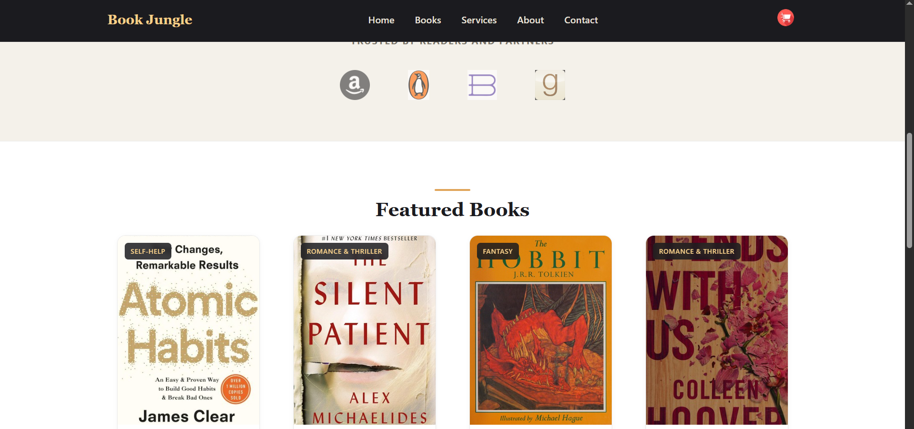
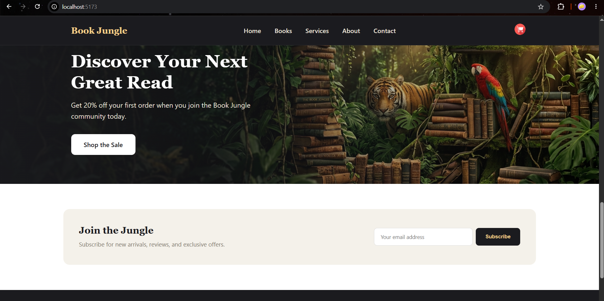
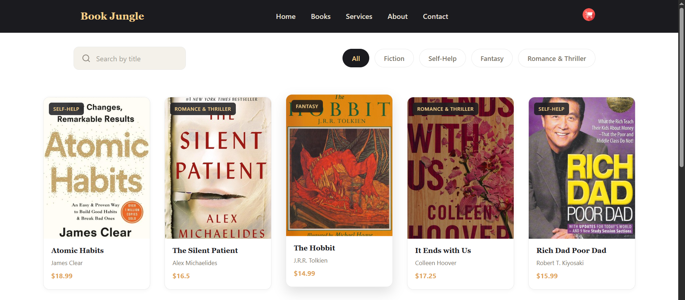
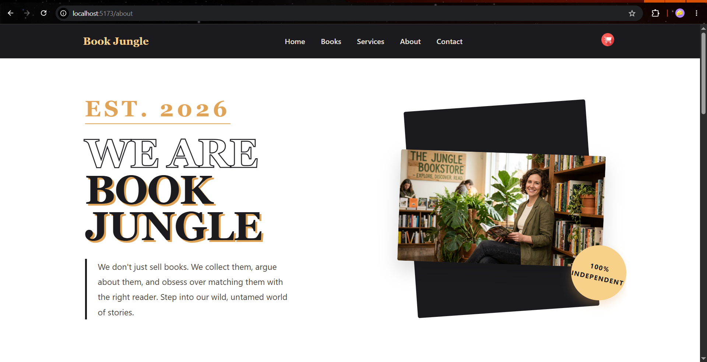
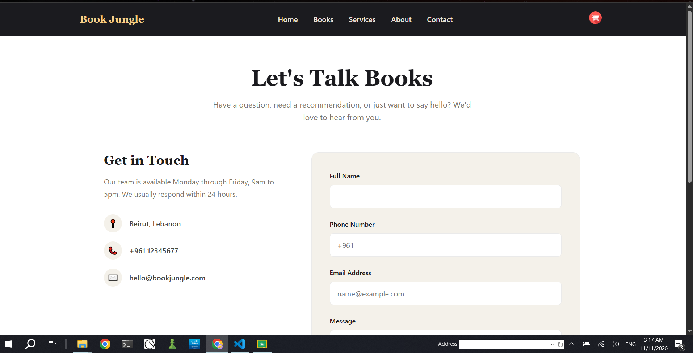

# Book Jungle 📚

## Project Description
**Book Jungle** is a online bookstore built with React.js. the application allows users to browse a curated collection of books, search by title, filter by category, and view dynamic, detailed pages for each specific book.

- Component-based architecture with separated CSS Modules.
- Client-side routing using React Router (including dynamic routing).
- Local data management and array filtering.
- Responsive web design using Flexbox and grid.

## Technologies Used
- **React.js** (via Vite)
- **React Router DOM** (for navigation and dynamic URLs)
- **CSS Modules** (for scoped, maintainable styling)
- **Google Fonts** (Georgia/Serif typography pairing)

